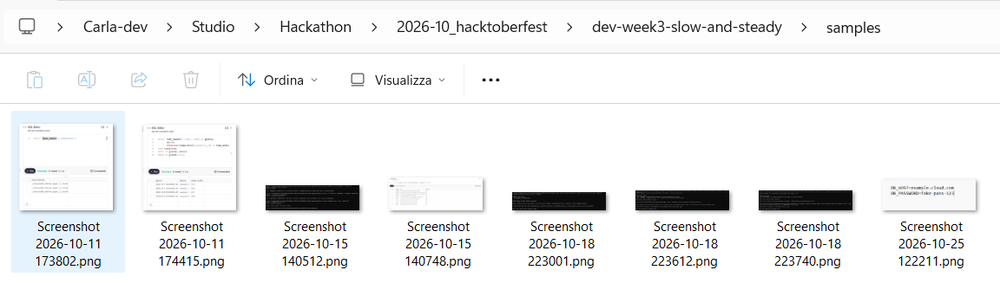
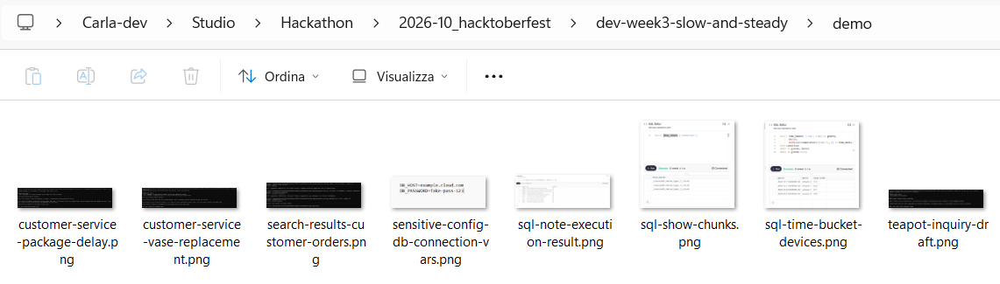
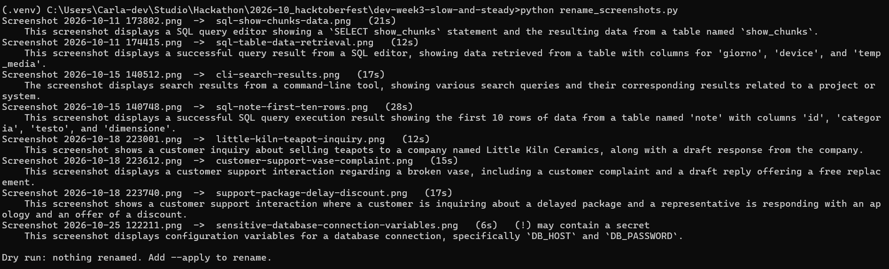

# Lazy Screenshot Namer

Turns `Screenshot 2026-10-11 173802.png` into `sql-show-chunks.png`. A local Gemma 4 model looks at each screenshot, describes it and suggests a name that says what's inside. It also flags screenshots that seem to contain a password or a key, before they end up in a repo or a blog post.

Everything runs on your laptop with Ollama: your screenshots never leave your machine.

Built for the [Hacktoberfest 2026 Open-Source AI Challenge, Week 3: Slow and Steady](https://dev.to/challenges/hacktoberfest-week3-2026-10-19).

## Before and after





| Windows name                     | Suggested by Gemma 4                    | My own name, chosen by hand         |
| -------------------------------- | --------------------------------------- | ----------------------------------- |
| Screenshot 2026-10-11 173802.png | sql-show-chunks.png                     | ghw-hypertable-show-chunks.png      |
| Screenshot 2026-10-11 174415.png | sql-time-bucket-devices.png             | ghw-hypertable-time-bucket.png      |
| Screenshot 2026-10-15 140512.png | search-results-customer-orders.png      | ghw-pgvector-ricerca.png            |
| Screenshot 2026-10-15 140748.png | sql-note-execution-result.png           | ghw-pgvector-tabella.png            |
| Screenshot 2026-10-18 223001.png | teapot-inquiry-draft.png                | demo-teapots.png                    |
| Screenshot 2026-10-18 223612.png | customer-service-vase-replacement.png   | demo-damaged.png                    |
| Screenshot 2026-10-18 223740.png | customer-service-package-delay.png      | demo-late.png                       |
| Screenshot 2026-10-25 122211.png | sensitive-config-db-connection-vars.png | (a fake password, made for testing) |

## How it works

For each image in a folder:

1. **Describe** (the slow step, with the image): Gemma 4 writes one sentence about what the screenshot shows, plus a line `sensitive: yes/no`.
2. **Name** (the fast step, text only): Gemma 4 turns that sentence into a file name of 2 to 5 words.
3. **Safety first**: by default it's a dry run that only prints suggestions. With `--apply` it renames, never overwrites an existing file, and appends every change to `rename_log.csv` so you can undo it. Screenshots flagged as sensitive get a `sensitive-` prefix.



## Run it

Requirements: Python 3.11+ and [Ollama](https://ollama.com).

```
ollama pull gemma4:e2b-it-qat
python -m venv .venv
.venv\Scripts\activate
pip install -r requirements.txt
```

Then:

```
python rename_screenshots.py                  # dry run on samples/: only shows suggestions
xcopy samples demo\ /I                        # (Windows) work on a copy
python rename_screenshots.py demo --apply     # really rename the copies
```

## What I learned

- **The 13,706-character file name.** My first version asked for JSON output. On most screenshots, Gemma 4 E2B got stuck repeating words inside the name and never closed the JSON: 4 minutes per image, no usable answer. Capping the output at 40 tokens fixed both problems: from about 4 minutes to about 9 seconds per image.
- **The model copied my example.** The prompt said "for example: sql-editor-query-results", and three different SQL screenshots got exactly that name. Removing the example and asking for "the most specific thing you can read on screen" made them distinct (`sql-show-chunks`, `sql-time-bucket-devices`).
- **Describe first, then name.** On terminal screenshots the model latched onto the command (`python copilot.py`) and ignored the content. Splitting the job in two simpler steps took me from 2 useful names out of 7 to 7 out of 7.
- **Don't trust the output.** The code keeps at most 5 words, strips anything that isn't a letter, a digit or a hyphen, and never overwrites files. Names also change slightly between runs, so you review the dry run before applying.
- **Small models read, but not perfectly.** It once read `hackthon-ghw` instead of `hackathon-ghw`, and called customer notes "customer orders".

## Limits and next steps

- 3 to 27 seconds per image on a laptop without a GPU: fine for a folder you'd never sort by hand anyway, as long as it runs unattended.
- It can't know your own project prefixes (like my `ghw-` and `demo-`) unless they're visible in the image. Next step: learn the naming style from the files already in a folder.
- The `sensitive` flag is a helpful warning, not a guarantee.
- Next: watch the Screenshots folder and rename new files automatically.
